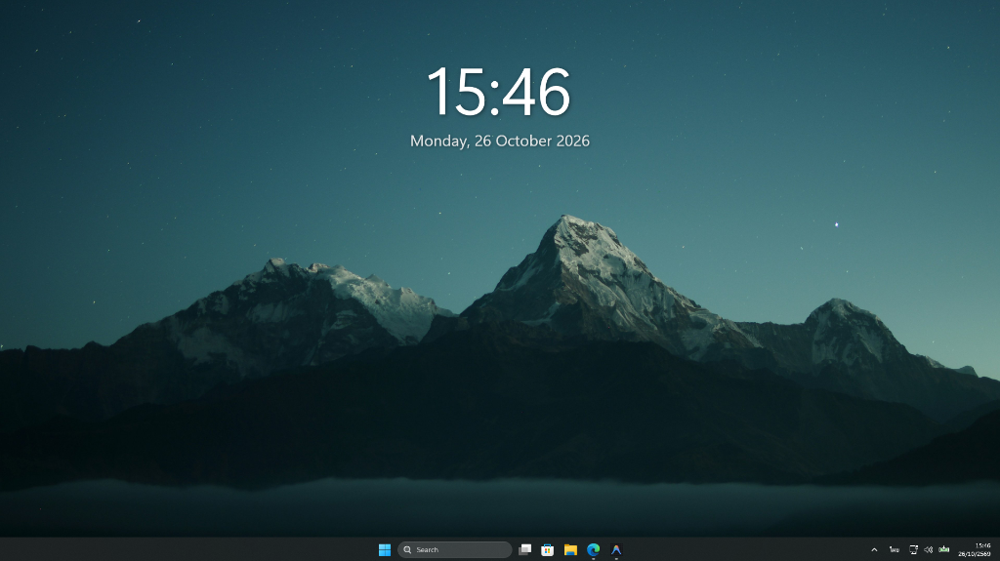

# CleanClock

A minimal, borderless desktop wallpaper clock widget for Windows built with C# and WPF.



## Features

- **Borderless & Transparent:** Clean typography floating directly over your desktop wallpaper without boxes or frames.
- **Customizable Text:** Choose from preset colors, a full color picker, font weights (Light, Regular, SemiBold), and drop shadow toggle.
- **Interactive Scaling:** Hover and scroll your mouse wheel to resize in real-time (70% to 200%).
- **Display Modes:**
  - **Desktop Wallpaper Layer:** Stays at the bottom desktop layer behind open application windows.
  - **Always on Top:** Floats above all open windows.
  - **Normal Window:** Behaves as a regular window.
- **Click-Through Mode:** Mouse clicks pass through the widget so it never interrupts your workflow or gaming.
- **Start with Windows:** Easily toggle automatic launch on system boot.
- **Persistent Position:** Automatically remembers its screen location across restarts.

## Quick Start

### Prerequisites
- Windows 10 / 11
- [.NET 8.0 SDK](https://dotnet.microsoft.com/) or newer

### Run
Clone the repository and run:
```bash
git clone https://github.com/FoamNR/widget-cleanclock.git
cd widget-cleanclock
dotnet run
```
Or launch via `RunClock.bat`.

## Controls

| Action | Control |
| :--- | :--- |
| **Move** | Left-click and drag |
| **Resize** | Hover and scroll mouse wheel |
| **Settings** | Right-click the clock or system tray icon |
| **Toggle Click-Through** | Double-click the system tray icon |

## License

This project is licensed under the [MIT License](LICENSE) - free for everyone to use, modify, and distribute without restriction.
